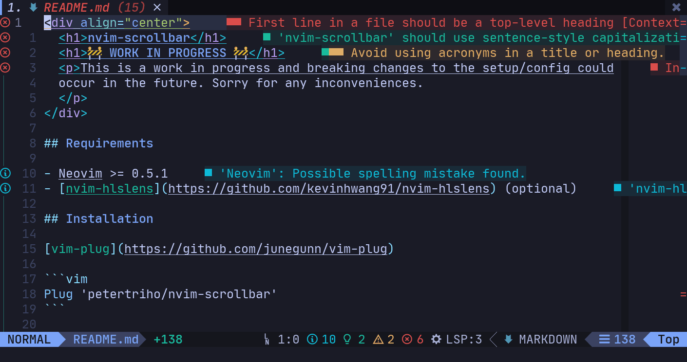

<div align="center">
  <h1>nvim-scrollbar</h1>
  <h5>Extensible floating scrollbars for Neovim</h5>
</div>

> [!IMPORTANT]
> On 2026-11-16, v2 replaces v1 on the `main` branch. v2 changes the `setup()`
> options, removes the `scrollbar.handlers` modules, and needs Neovim 0.11 or
> newer. To keep v1, pin the `v1` branch or the `v1.0.0` tag. See
> [#121](https://github.com/petertriho/nvim-scrollbar/issues/121).



`nvim-scrollbar` shows one floating scrollbar for each source window. Each
split window gets its own thumb. The scrollbar has typed mark lanes, optional
screen-row geometry, and mouse navigation. An optional floating minimap shows a
compressed view of the buffer, with a viewport tint, a cursor accent, provider
marks, and mouse navigation.

## Requirements

- Neovim 0.11 or newer
- The user's Neovim `mouse` option must enable the desired modes for mouse
  interaction, for example `set mouse=a`. The plugin never changes `mouse`.
- Optional integrations:
  [gitsigns.nvim](https://github.com/lewis6991/gitsigns.nvim),
  [mini.diff](https://github.com/nvim-mini/mini.diff),
  [vim-signify](https://github.com/mhinz/vim-signify),
  [vgit.nvim](https://github.com/tanvirtin/vgit.nvim),
  [ALE](https://github.com/dense-analysis/ale), and
  [coc.nvim](https://github.com/neoclide/coc.nvim)

## Installation

If you upgrade from v1, read the [migration guide](docs/migration.md) first.
If you are not ready to migrate, pin the `v1` branch, for example
`{ "petertriho/nvim-scrollbar", branch = "v1" }` with lazy.nvim.

[lazy.nvim](https://github.com/folke/lazy.nvim):

```lua
{
    "petertriho/nvim-scrollbar",
    opts = {},
}
```

`opts = {}` calls `require("scrollbar").setup({})` automatically. Put any
configuration overrides inside `opts`.

[vim-plug](https://github.com/junegunn/vim-plug):

```vim
Plug 'petertriho/nvim-scrollbar'
```

With vim-plug or another manual installation, configure the plugin from Lua:

```lua
require("scrollbar").setup()
```

## Quick Start

By default, the cursor, diagnostic, search, and named-mark providers are
enabled for every eligible source window. A small custom setup can look like
this:

```lua
require("scrollbar").setup({
    providers = {
        search = { incsearch = true },
        marks = { numbers = true },
    },
    scrollbar = {
        preset = "zed",
        autohide = true,
    },
})
```

This example enables autohide. The scrollbars start hidden. Cursor movement or
scrolling in a source window shows its scrollbar.

The built-in presets are `vscode`, `zed`, `intellij`, `minimal`, `review`,
`search`, `navigate`, `gvim`, `eclipse`, `sublime`, `emacs`, and `xcode`. An
ordered list of profiles can select a different appearance for each source
window:

```lua
require("scrollbar").setup({
    scrollbar = {
        preset = "zed",
        profiles = {
            {
                match = { filetypes = { "markdown", "text" } },
                preset = "minimal",
            },
            {
                match = { filetypes = { "lua" } },
                preset = "review",
            },
        },
    },
})
```

The first profile that matches is used. Profiles change only appearance
options. Providers, exclusions, visibility, autohide, and `max_lines` are
global.

Setup rejects unknown keys and invalid values. See the
[configuration reference](docs/configuration.md) for every default and accepted
value.

## Minimap

The minimap is disabled by default. It has its own configuration block,
profiles, mouse handling, and commands. It does not show, hide, or move the
scrollbar. Both renderers share the top-level `providers`, `marks`, and
`exclude` tables.

```lua
require("scrollbar").setup({
    minimap = {
        enabled = true,
    },
})
```

By default, each source window gets a 16-column minimap at its north-east
corner, beside the scrollbar. Each minimap row represents a group of source
lines. Occupied cells
show the single-width `glyph` (`"█"` by default). Treesitter and LSP
semantic-token colors are opt-in providers:

```lua
require("scrollbar").setup({
    providers = {
        treesitter = true,
        lsp_semantic_tokens = true,
    },
    minimap = {
        enabled = true,
    },
})
```

Provider marks, such as diagnostics, search matches, and Git hunks, tint the
occupied cells of their row. `minimap.marks` changes the priority or the
highlight of a mark type for the minimap. `false` hides a type:

```lua
require("scrollbar").setup({
    minimap = {
        enabled = true,
        marks = {
            Search = { priority = 0, highlight = "IncSearch" },
            Hint = false,
        },
    },
})
```

`minimap.blend` sets the blend of the full float. `minimap.background_blend`
sets the blend of only the base surface. See
[Minimap configuration](docs/minimap/configuration.md#blend). By default, the
minimap of the active source window hides while the editing cursor is inside
it.

The automatic minimap groups have their own public names, such as
`ScrollbarMinimapSearch`. Setup keeps your existing definitions of the public
scrollbar and minimap groups.

See the [minimap documentation](docs/minimap/README.md) for placement, marks,
and mouse behavior.

## Providers

| Provider | Scrollbar | Minimap | Source | Dependency |
| --- | --- | --- | --- | --- |
| [`cursor`](docs/providers/cursor.md) | on | on | Source-window cursor | None |
| [`diagnostic`](docs/providers/diagnostic.md) | on | on | Neovim `vim.diagnostic` | None |
| [`search`](docs/providers/search.md) | on | on | Native `/` and `?` search | None |
| [`marks`](docs/providers/marks.md) | on | on | Letter marks, and optional numbered marks | None |
| [`gitsigns`](docs/providers/gitsigns.md) | off | off | Git hunks | gitsigns.nvim |
| [`mini_diff`](docs/providers/mini_diff.md) | off | off | mini.diff hunks | mini.diff |
| [`signify`](docs/providers/signify.md) | off | off | vim-signify hunks | vim-signify |
| [`vgit`](docs/providers/vgit.md) | off | off | vgit hunks | vgit.nvim |
| [`ale`](docs/providers/ale.md) | off | off | ALE location list | ALE |
| [`coc`](docs/providers/coc.md) | off | off | Coc diagnostic list | coc.nvim |
| [`treesitter`](docs/providers/treesitter.md) | unavailable | off | Treesitter highlight captures | Installed parser |
| [`lsp_semantic_tokens`](docs/providers/lsp_semantic_tokens.md) | unavailable | off | LSP semantic tokens | Attached LSP client |

Configure the providers in the top-level `providers` table. A provider value is
`false`, `true`, or a table of options. In a table, the `scrollbar` and
`minimap` flags select the renderers that show the provider. Each built-in
provider runs once, and only when an enabled renderer uses it.

See the [provider overview](docs/providers/README.md) for the shared rules,
dependencies, update behavior, and links to every provider. To add a new data
source, use the [custom provider API](docs/providers/custom.md).

## Documentation

### Guides

- [Configuration](docs/configuration.md): defaults, providers, exclusions, mark
  types, layout lanes, profiles, precedence, and validation
- [Presets](docs/presets.md): the twelve built-in presets and their precedence
- [Visibility](docs/visibility.md): source-window visibility, autohide,
  hide-on-cursor behavior, commands, and Lua APIs
- [Layout and geometry](docs/layout-and-geometry.md): layout lanes, placement,
  line and screen geometry, and wide scrollbars
- [Mouse](docs/mouse.md): clicks, mark navigation, thumb dragging, and focus
  behavior
- [Highlights](docs/highlights.md): generated groups, direct definitions,
  blending, and manual highlights
- [Migration](docs/migration.md): changes required from earlier releases
- [Development](docs/development.md): tests, quality checks, benchmarks, and CI

### Provider Guides

- [Provider overview](docs/providers/README.md)
- [Cursor](docs/providers/cursor.md)
- [Diagnostics](docs/providers/diagnostic.md)
- [Search](docs/providers/search.md)
- [Marks](docs/providers/marks.md)
- [Gitsigns](docs/providers/gitsigns.md)
- [MiniDiff](docs/providers/mini_diff.md)
- [Signify](docs/providers/signify.md)
- [Vgit](docs/providers/vgit.md)
- [ALE](docs/providers/ale.md)
- [Coc](docs/providers/coc.md)
- [Treesitter](docs/providers/treesitter.md)
- [LSP semantic tokens](docs/providers/lsp_semantic_tokens.md)
- [Custom providers](docs/providers/custom.md)

### Minimap Guides

- [Minimap overview](docs/minimap/README.md): placement, size, marks, and mouse
  behavior
- [Minimap configuration](docs/minimap/configuration.md)

## License

[MIT](LICENSE)
